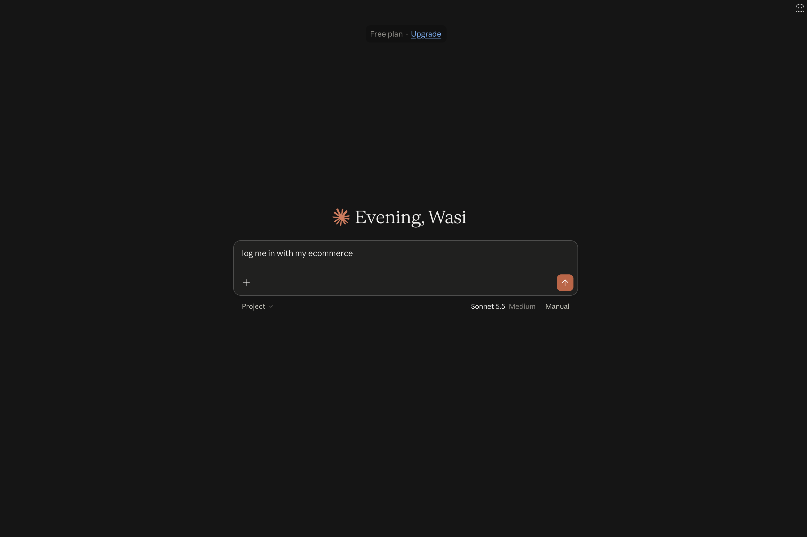
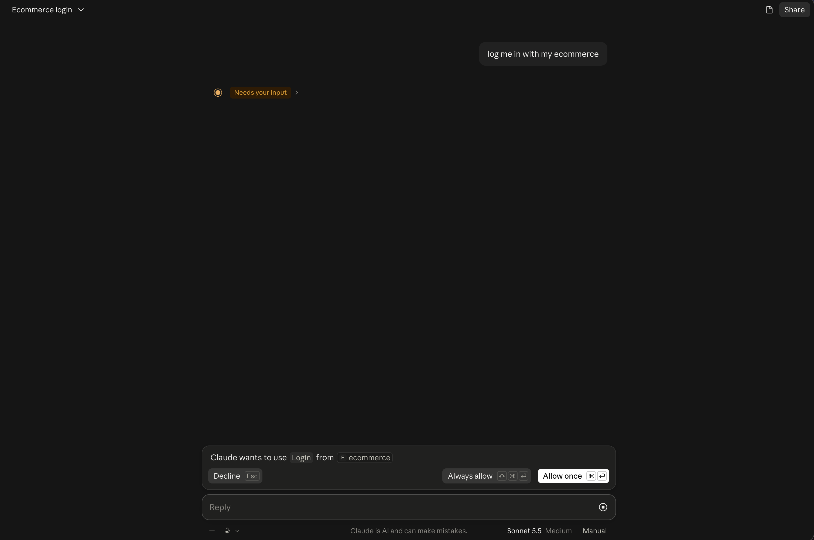
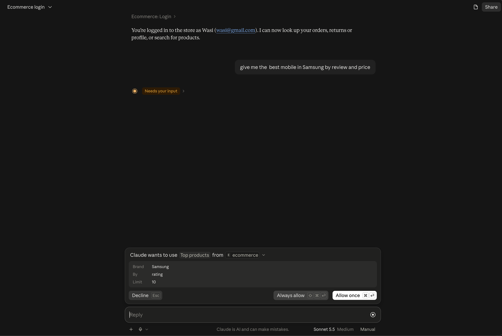
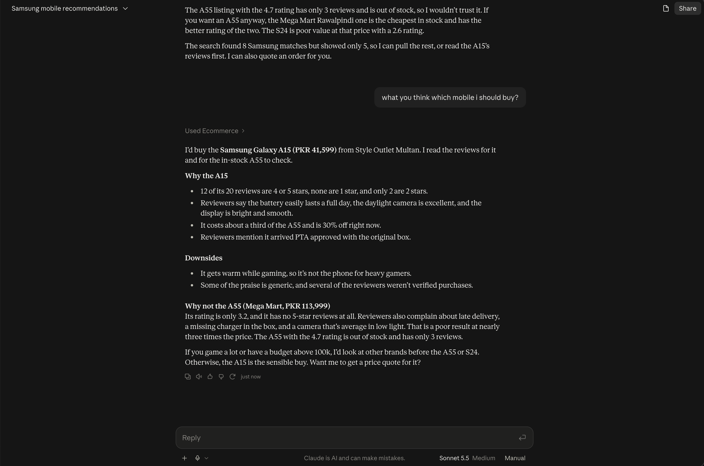
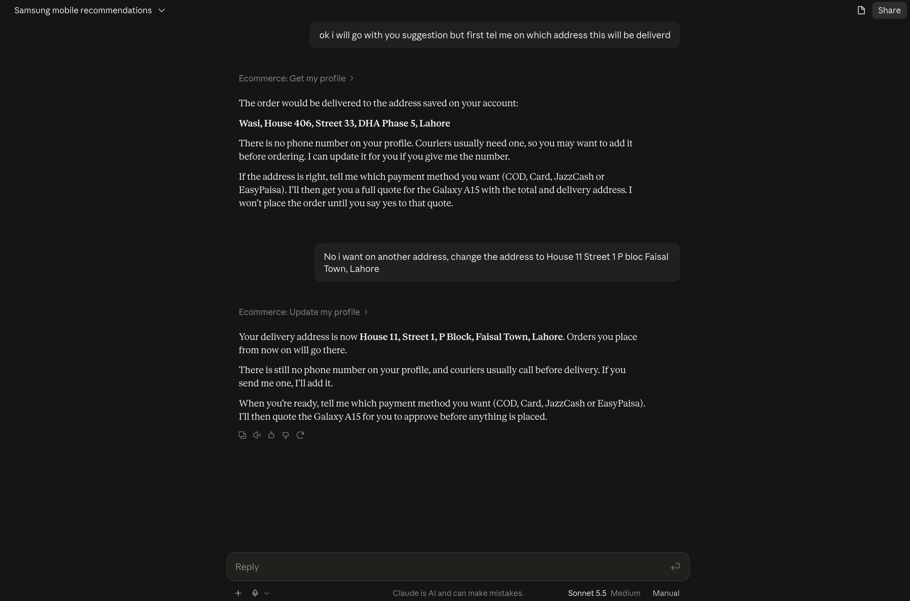
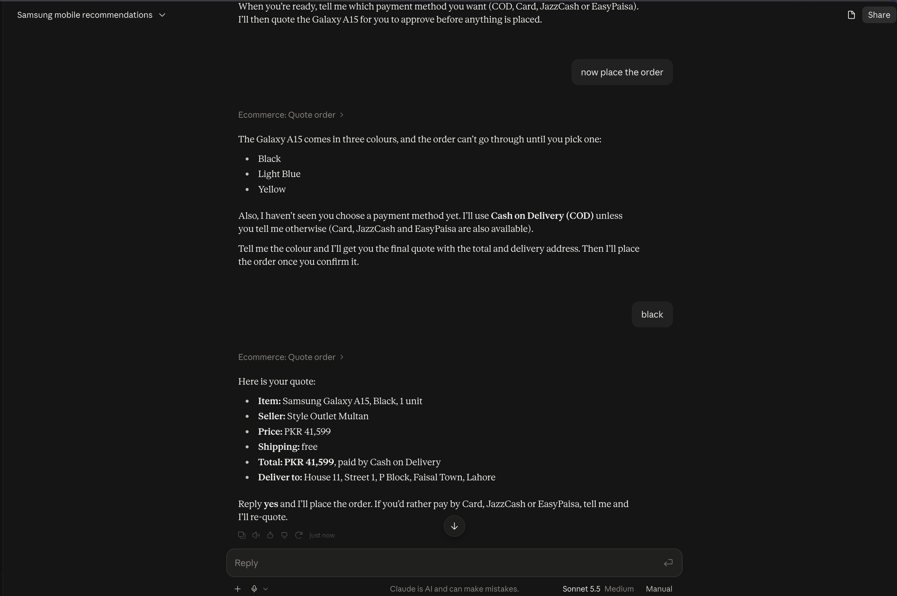
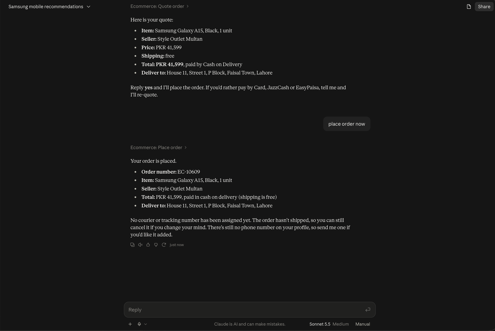

# E-commerce MCP Server

A **Model Context Protocol (MCP) server** that lets Claude shop a Daraz-style online marketplace through natural language. Ask Claude to find products, compare sellers, read reviews, place orders, cancel them or request returns. Claude calls the server's tools, and the server reads and writes **Firebase**.

Built with **Python**, the official **MCP SDK (FastMCP)** and **Firebase** (Firestore + Authentication). Runs locally over **stdio** with **Claude Desktop** or any other MCP client.

> **Demo data.** Prices, sellers and reviews are fictional and not affiliated with any brand. Brand and model names are used only to make the demo realistic.

---

## What you can say to Claude

```
"Show me the top 5 rated Apple mobiles"
"Find Samsung phones under 50,000 with free shipping, cheapest first"
"Compare these two phones and tell me which seller is better"
"Show me the 1-star reviews of this product"
"Order 1 Samsung Galaxy A15 in Black from the cheapest seller, cash on delivery"
"Show my orders" / "Where is my shipped order?"
"Cancel my order EC-10605"
"I want to return the order delivered 4 days ago, it was damaged"
"Update my address to House 12, Street 4, Johar Town, Lahore"
```

Claude picks the right tools, chains them (search → reviews → quote → order) and answers from real data in Firestore, never from the web.

---

## Screenshots

Claude Desktop talking to this MCP server. Images live in [`screenshoot/`](screenshoot/) so they show on GitHub after you push the repo.

### 1. Ask Claude to log in

The user starts a chat and asks Claude to sign in to the store. Credentials come from `.env`, not from the chat.



### 2. Claude asks to use the Login tool

Claude Desktop shows a permission prompt: **Claude wants to use Login from ecommerce**. Allow once (or always) so the `login` tool can run.



### 3. Search for the best Samsung mobile

After login, the user asks for the best Samsung phone by review and price. Claude requests **Top products** (`brand: Samsung`, `by: rating`).



### 4. Ranked results from the store

Claude returns a **best pick** (Samsung Galaxy A15, Style Outlet Multan) and a comparison table of other Samsung listings, using ratings, stock and price from Firestore.

_mbl_resutls.png>)

### 5. Ask Claude which phone to buy

The user asks Claude to choose. It reads reviews, compares sellers, and recommends the Galaxy A15 with reasons for and against.



### 6. Check and change the delivery address

Before ordering, Claude loads the saved address with `get_my_profile`. The user asks to change it; Claude updates the profile with `update_my_profile`.



### 7. Pick a colour and get a quote

Claude will not place the order until a colour is chosen. After **black**, `quote_order` shows item, seller, price, free shipping, COD and the new delivery address — and waits for confirmation.



### 8. Place the order

The user confirms. `place_order` creates the order (here **EC-10609**) and notes that it can still be cancelled because it has not shipped.



---

## Features

- **20 MCP tools** covering account, products, reviews, sellers, orders and returns
- **Login from `.env`.** The password never passes through the chat
- **Product search** across name, brand, model and category, with filters (price range, brand, category, in stock, free shipping)
- **Rankings** by rating, number of reviews, best selling, lowest or highest price, and discount
- **Price comparison.** Each product page shows the same item from other sellers
- **Reviews** with a star breakdown and a star filter (e.g. only the complaints)
- **Seller profiles** with rating, positive feedback %, followers and best sellers
- **Safe ordering.** `quote_order` shows the price first and `place_order` runs only after the user confirms
- **Transactions** for placing, cancelling and returning orders, so stock never goes wrong
- **Business rules in code**: stock, variants, quantity limits, shipping, cancel window, 7-day return window
- **Privacy.** Users only see their own orders, returns and profile; other users' contact details are never returned
- **Realistic seed data**: 330 products, 3,200 reviews, 40 sellers, 300 users, 600+ orders

---

## How it works

```
You (chat) ──► Claude Desktop ── runs the LLM + the tool loop
                   │
                   │  stdio · JSON-RPC (initialize → tools/list → tools/call)
                   ▼
               server.py ── FastMCP("ecommerce") + the TOOLS list
                   │
                   ▼
             Tools (*_tools.py) ── login check → validate → repository calls → rules → small, safe dict
               │                    │
               ▼                    ▼
       Rules + pricing         Repositories (*_repository.py)
       (pure functions)              │  Firebase Admin SDK
                                     ▼
                         Firebase: Firestore + Authentication
```

1. **Claude Desktop** starts `server.py` itself, using the path in its config file.
2. On connect, the server sends its **instructions** and the **tool cards** (name, docstring, JSON schema from the type hints).
3. For each message, Claude decides which tool to call. The server runs that Python function and returns a small JSON result.
4. Claude repeats this until it has enough information, then answers in text.

The LLM never touches the database. It can only call the tools, and every tool checks the login and the rules first.

---

## Tools

| Group | Tool | What it does |
|---|---|---|
| Auth | `login` | Sign in with the account in `.env` (no arguments) |
| | `logout` | End the session |
| | `who_am_i` | Show the logged-in account |
| Account | `get_my_profile` | Name, email, phone, city, delivery address |
| | `update_my_profile` | Update name, phone, city or address (validated) |
| Products | `list_categories` | All categories with product counts |
| | `search_products` | Search with filters and sorting |
| | `top_products` | Rank by rating, reviews, best selling, price or discount |
| | `get_product_details` | Full details and the same product from other sellers |
| | `compare_products` | Compare 2–4 products (cheapest, best rated, best selling, fastest delivery) |
| Reviews | `get_product_reviews` | Star breakdown, filter by stars, sort by helpful or newest |
| Sellers | `get_seller_profile` | Seller by id or part of the shop name, with best sellers |
| | `get_seller_reviews` | What customers say about a seller |
| Orders | `quote_order` | Price an order **without** placing it |
| | `place_order` | Place the order after the user confirms (transaction) |
| | `get_my_orders` | The user's orders, newest first, optional status filter |
| | `get_order_details` | Items, totals, tracking, timeline, can cancel / can return |
| | `cancel_my_order` | Cancel before shipping and restock the items (transaction) |
| Returns | `request_return` | Return a delivered order within 7 days (transaction) |
| | `get_my_returns` | The user's return requests and refund status |

---

## Tech stack

| Part | Tool |
|---|---|
| MCP server | Official Python SDK `mcp` v1 (`FastMCP`), stdio transport |
| Database | Cloud Firestore (Firebase Admin SDK) |
| Login | Firebase Authentication (email + password, REST `signInWithPassword`) |
| Config | pydantic-settings + `.env` |
| Validation | Pydantic models and type hints |
| Seed data | Faker + hand-written brand catalog |
| Testing | MCP Inspector, Claude Desktop |

---

## Project structure

```
ecommerce_mcp_server/
├── server.py                        # MCP entry point: registers all tools, runs over stdio
├── ecommerce/
│   ├── app_settings.py              # settings from .env
│   ├── firebase_connection.py       # one shared Firestore client
│   ├── server_logging.py            # logs to stderr (stdout is reserved for MCP)
│   ├── collection_names.py          # Firestore collection names
│   ├── auth/
│   │   ├── firebase_login.py        # email + password sign-in (Firebase Auth REST)
│   │   ├── login_session.py         # logged-in user + require_login()
│   │   └── auth_tools.py            # login, logout, who_am_i
│   ├── account/
│   │   ├── account_repository.py    # read / update the user's own profile
│   │   └── account_tools.py         # get_my_profile, update_my_profile
│   ├── products/
│   │   ├── product_repository.py    # read products and categories
│   │   ├── product_search.py        # filter and sort logic (pure, testable)
│   │   ├── product_card.py          # safe product dicts for Claude
│   │   └── product_tools.py         # search, top, details, compare, categories
│   ├── reviews/
│   │   ├── review_repository.py
│   │   └── review_tools.py          # get_product_reviews
│   ├── sellers/
│   │   ├── seller_repository.py
│   │   └── seller_tools.py          # get_seller_profile, get_seller_reviews
│   ├── orders/
│   │   ├── order_rules.py           # what can be ordered, cancelled, returned (pure)
│   │   ├── order_pricing.py         # server-side prices, shipping, totals (pure)
│   │   ├── order_repository.py      # place / cancel orders in transactions
│   │   └── order_tools.py           # quote, place, list, details, cancel
│   └── returns/
│       ├── return_repository.py     # create returns in a transaction
│       └── return_tools.py          # request_return, get_my_returns
├── scripts/
│   ├── check_firebase_connection.py # prints document count per collection
│   └── seed_ecommerce.py            # creates all demo data
├── tests/
├── screenshoot/                     # Claude Desktop screenshots used in this README
├── .env.example
└── requirements.txt
```

Every feature has the same three layers:
- **repository**: database only
- **rules**: pure business logic
- **tools**: what the LLM sees

---

## Demo data

`scripts/seed_ecommerce.py` creates a realistic Pakistani marketplace. Prices are in PKR.

| Collection | Count | Notes |
|---|---|---|
| categories | 8 | Mobiles, Electronics, Fashion, Bags, Home & Kitchen, Beauty, Sports, Watches |
| sellers | 40 | Fictional shops across Pakistani cities, good and bad sellers |
| products | ~330 | Real brands and models, each listed by 2–6 sellers at different prices |
| reviews | ~3,200 | Mixed good and bad reviews in English and Roman Urdu |
| seller_reviews | ~700 | Feedback on delivery, packing and communication |
| users | 300 + you | Pakistani names; contact details are private |
| orders | ~600 + 7 | Every status: placed, confirmed, shipped, delivered, cancelled, returned |
| returns | ~70 | From returned orders |

Your own account gets **7 test orders** in every status (placed, confirmed, shipped, delivered 4 days ago, delivered 25 days ago, cancelled, returned). That way you can test cancel and return rules right away.

Every seeded document has `seeded: true`, and `--reset` removes only those documents.

---

## Getting started

### 1. Install

```bash
git clone https://github.com/<your-username>/ecommerce-mcp-server.git
cd ecommerce-mcp-server
python3 -m venv venv
source venv/bin/activate
pip install -r requirements.txt
```

> The code uses MCP SDK **v1** (`mcp<2`). In v2 `FastMCP` was renamed, so keep the pinned version.

### 2. Create a Firebase project

1. Create a project in the [Firebase Console](https://console.firebase.google.com/).
2. **Firestore Database**: create it in production mode. The server uses the Admin SDK, which bypasses security rules.
3. **Authentication → Sign-in method**: enable **Email/Password**.
4. **Project settings → Service accounts → Generate new private key**: save it in the project root as `firebase-key.json`.
5. **Project settings → General → Add app → Web (`</>`)**: copy the `apiKey`. This is the Web API key.

> `firebase-key.json` gives full access to your project. It is in `.gitignore`. Never commit or share it.

### 3. Configure `.env`

```bash
cp .env.example .env
```

```env
FIREBASE_SERVICE_ACCOUNT_PATH=firebase-key.json
FIREBASE_PROJECT_ID=your-project-id
FIREBASE_WEB_API_KEY=your-web-api-key

# the store account Claude logs in with (created by the seed script)
STORE_USER_NAME=Your Name
STORE_USER_EMAIL=you@example.com
STORE_USER_PASSWORD=choose-a-password
STORE_USER_CITY=Lahore

MAX_RESULTS=10
SHIPPING_FEE_PKR=150
FREE_SHIPPING_ABOVE_PKR=2000
RETURN_WINDOW_DAYS=7
```

### 4. Seed the data

```bash
python -m scripts.check_firebase_connection   # every count should be 0
python -m scripts.seed_ecommerce              # creates all demo data + your account
python -m scripts.check_firebase_connection   # now shows the counts
```

### 5. Test with MCP Inspector (optional)

```bash
npx @modelcontextprotocol/inspector venv/bin/python server.py
```

Open the link printed in the terminal (it contains `MCP_PROXY_AUTH_TOKEN`) and click **Connect**. Then open **Tools → List Tools** and run `login`, followed by any other tool.

### 6. Connect to Claude Desktop

Open **Claude Desktop → Settings → Developer → Edit Config** and add the server to `claude_desktop_config.json`, using **absolute paths**:

```json
{
  "mcpServers": {
    "ecommerce": {
      "command": "/absolute/path/to/ecommerce-mcp-server/venv/bin/python",
      "args": ["/absolute/path/to/ecommerce-mcp-server/server.py"]
    }
  }
}
```

Quit Claude Desktop completely (`Cmd + Q`) and open it again. **Settings → Developer** should show **ecommerce · Running**. Start a new chat, make sure **ecommerce** is enabled in the tools menu, and ask:

> Show me the top 5 rated Apple mobiles from the ecommerce store

Claude Desktop starts and stops the server by itself. After changing the code, restart Claude Desktop.

---

## Business rules

All rules are enforced in code, so they hold even if the model makes a mistake.

| Rule | Value |
|---|---|
| Max quantity per item | 5 |
| Max items per order | 10 |
| Shipping | PKR 150, free above PKR 2,000 or when every item has free shipping |
| Prices | Always read from Firestore when the order is placed, never taken from the chat |
| Cancel | Only while the order is `placed` or `confirmed`; items go back in stock |
| Return | Only `delivered` orders, within 7 days, one return per order |
| Rating ranking | Only products with at least 3 reviews |
| Results | At most 10 per call |
| Phone | Pakistani mobile format (`03001234567` or `+923001234567`) |

---

## Security and design decisions

- **Login in every tool.** Each tool starts with `require_login()`.
- **User id from the session, never from the model.** Claude cannot ask for another user's data. Someone else's order number returns "not found", so its existence is not revealed.
- **Private fields are never returned.** Reviews show only the reviewer's display name.
- **The server calculates every price.** Totals come from Firestore, not from the conversation.
- **Confirm before writing.** The server instructions tell Claude to show `quote_order` and wait for a clear yes. Cancelling, returning and profile changes are confirmed the same way.
- **Transactions.** Placing, cancelling and returning re-read the latest data and write everything at once, with all reads before writes.
- **Errors as results.** Tools return `{"status": "not_found" | "not_allowed" | "invalid", ...}` so Claude can explain the problem or try another step.
- **No `print()`.** In a stdio server, stdout carries the MCP messages, so logs go to stderr.
- **Secrets stay local.** `.env` and `firebase-key.json` are git-ignored, and the password never appears in the chat.

---

## Challenges and how I solved them

**1. Searching by name in Firestore**
Firestore has no "contains" or multi-word text search.
**Fix:** load the ~330 products and filter in Python. Every query word must appear in the name, brand, model or category, in any order, so "a15 samsung" works.

**2. A 5-star product with one review ranked above a 4.6 with forty**
**Fix:** rating rankings only count products with at least 3 reviews.

**3. The model could invent prices or order other users' items**
**Fix:**
- prices are calculated on the server
- the user id comes from the session
- every rule lives in code, not in the prompt

**4. Two people buying the last item at the same time**
**Fix:** orders are placed in a Firestore transaction. Stock is checked again inside it, and one update per product is written.

**5. Orders placed by mistake**
**Fix:** a separate `quote_order` tool, plus server instructions to show the quote and wait for confirmation before `place_order`.

**6. `No module named 'mcp.server.fastmcp'`**
pip installed MCP SDK v2, where `FastMCP` was renamed.
**Fix:** pin `mcp[cli]<2` in `requirements.txt`.

**7. Claude answered from web search instead of the store**
**Fix:**
- check the server shows Running
- enable it in the chat's tools menu
- mention "the ecommerce store" in the prompt
- clear docstrings, so Claude knows when each tool applies

**8. Server failed to start in Claude Desktop with no clear error**
**Fix:** run `venv/bin/python server.py` in a terminal to see the traceback, or check `~/Library/Logs/Claude/mcp-server-ecommerce.log`.

**9. Claude Desktop launches the server from another folder**
**Fix:** every path (`.env`, `firebase-key.json`) is resolved from the project root, not the current directory.

---

## Limitations and future work

- **Remote MCP.** Run over HTTP (`streamable-http`) with OAuth and deploy it, so it works as a Claude connector on web and mobile
- **Caching.** Product search reads every product, so a short cache (about 15 minutes) would cut Firestore reads
- **MCP SDK v2.** Migrate to the renamed `MCPServer` API
- **Payments.** Payment methods are recorded only; no real payment gateway
- **Seller side.** Sellers can't confirm, ship or approve returns yet; statuses move only through the seed data
- **Partial returns.** A return covers the whole order
- **Automated tests** for the order rules, pricing and search

---

## Related projects

This server is part of my AI learning path (LLM → RAG → Agent → MCP):

- **AskMyDocs**: a RAG backend and Flutter app for chatting with PDFs ([askmydocs-app](https://github.com/wasimasghar/askmydocs-app))
- **Proposal Agent**: a FastAPI + Gemini agent that matches a resume to a job and writes the proposal, with a React frontend

---

## License

MIT
